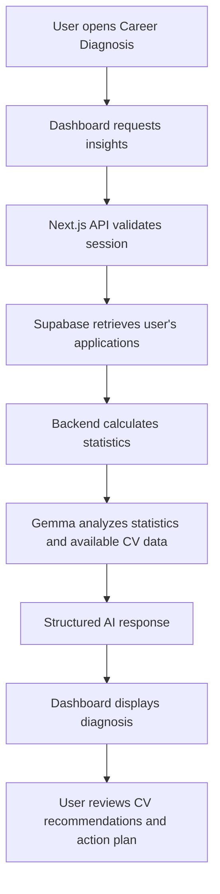

# Pathwise - AI-Powered Career Insights

Pathwise is an AI-powered career tracking and insights platform designed to help job seekers manage their applications, understand their job-search performance, and improve their CVs through data-driven insights.

Unlike traditional job trackers, Pathwise goes beyond recording applications. It analyzes application outcomes, identifies potential bottlenecks, and uses AI to provide personalized career recommendations and practical action plans.

> **Project status:** MVP in development

## Table of Contents

- [Overview](#overview)
- [Problem Statement](#problem-statement)
- [MVP Features](#mvp-features)
- [Technology Stack](#technology-stack)
- [Application Architecture](#application-architecture)
- [Getting Started](#getting-started)
- [Environment Variables](#environment-variables)
- [Database Structure](#database-structure)
- [How AI Insights Work](#how-ai-insights-work)
- [Security](#security)
- [Future Improvements](#future-improvements)
- [Contributing](#contributing)
- [License](#license)

## Overview

Job seekers often submit numerous applications without understanding how effective their job-search strategy is. They may struggle to track applications, measure interview conversion rates, identify CV weaknesses, or determine what to improve next.

Pathwise addresses this challenge by combining:

- Job application management.
- Career performance analytics.
- AI-powered career diagnosis.
- CV improvement recommendations.
- Personalized action plans.

The goal is to help users turn their job-search history into actionable insights.

## Problem Statement

Many job seekers lack a centralized and intelligent way to evaluate their job-search progress.

Traditional application trackers help users organize applications, but they rarely explain performance patterns or provide personalized recommendations for improving future applications.

Pathwise aims to bridge this gap by combining structured application data with AI-assisted analysis.

## MVP Features

### 1. User Authentication

Users can securely register, sign in, and access a personalized dashboard.

Authentication and user data management are handled through Supabase.

### 2. Job Application Tracking

Users can create, view, update, and delete job application records.

Each application can include:

- Company name.
- Job title.
- Application date.
- Application status.
- Interview, offer, and hiring outcomes.
- CV information.
- Job description.
- Rejection or interview feedback, where available.
- Personal expectations and mood.

### 3. Career Analytics Dashboard

Pathwise calculates performance metrics from the user's recorded applications.

The dashboard provides:

- Total applications.
- Interviews received.
- Offers received.
- Jobs secured.
- Application-to-interview conversion rate.
- Interview-to-offer conversion rate.
- Hiring rate.
- Application trends over time.
- Performance comparisons across roles when enough data exists.

### 4. AI-Powered Career Diagnosis

Pathwise uses a hosted Gemma model to analyze application statistics and available supporting information.

The AI generates:

- A summary of application performance.
- Identification of possible application bottlenecks.
- Evidence-based hypotheses about potential weaknesses.
- Explanations of observed patterns.
- Important limitations where data is incomplete.

AI-generated explanations are treated as hypotheses unless supported by direct evidence. Pathwise does not claim to know an employer's actual reason for rejection without reliable information.

### 5. AI-Assisted CV Improvement

Users can provide CV text for analysis.

Pathwise can recommend improvements to:

- Project descriptions.
- Work experience statements.
- Skills presentation.
- Achievement descriptions.
- Relevance to a target role.
- Clarity and structure of CV content.

Where the relevant information is available, the AI can suggest example rewrites. Users are responsible for verifying that all suggested claims are accurate.

### 6. Personalized Action Plan

Based on the user's application data and available CV information, Pathwise generates prioritized recommendations.

Examples include:

- Tailoring a CV to a target role.
- Improving the presentation of relevant projects.
- Recording missing application outcomes.
- Reviewing interview feedback.
- Focusing on areas where the available data indicates improvement may be useful.

## Technology Stack

| Technology | Purpose |
|---|---|
| Next.js | React framework and application routing |
| TypeScript | Type-safe application development |
| React | User interface |
| Tailwind CSS | Responsive styling |
| Supabase Auth | User authentication |
| Supabase PostgreSQL | Application data storage |
| Supabase Row Level Security | User data access control |
| Next.js Route Handlers | Backend API endpoints |
| Google GenAI SDK | Integration with hosted Gemma |
| Gemma | AI-powered career analysis |
| Lucide React | Interface icons |

## Application Architecture

Pathwise uses a Next.js application with client-side dashboard components and server-side API routes.

```text
Pathwise
│
├── app/
│   ├── api/
│   │   └── career-insights/
│   │       └── route.ts
│   │
│   ├── dashboard/
│   │   ├── page.tsx
│   │   └── components/
│   │       ├── DashboardHeader.tsx
│   │       ├── SummaryCards.tsx
│   │       ├── ApplicationTable.tsx
│   │       ├── ChartsGrid.tsx
│   │       ├── ResumeInsights.tsx
│   │       └── SuccessAnalysis.tsx
│   │
│   └── ...
│
├── lib/
│   └── supabase.ts
│
├── public/
│
├── .env.local
├── package.json
├── tsconfig.json
└── README.md
```

### AI Insights Request Flow



## Getting Started

### Prerequisites

Ensure you have the following installed:

- Node.js 20 or later.
- npm.
- Git.
- A Supabase project.
- A Google AI Studio API key with access to a supported Gemma model.

### 1. Clone the Repository

```bash
git clone https://github.com/Abel-Ronoh/Pathwise.git
```

Navigate into the project directory:

```bash
cd Pathwise
```

> Replace the repository URL if your GitHub repository uses a different name or URL.

### 2. Install Dependencies

```bash
npm install
```

Install the required packages if they are not already included:

```bash
npm install @supabase/supabase-js @google/genai lucide-react
```

### 3. Configure Environment Variables

Create a `.env.local` file in the project root.

```env
NEXT_PUBLIC_SUPABASE_URL=your_supabase_project_url
NEXT_PUBLIC_SUPABASE_ANON_KEY=your_supabase_anon_key

GEMINI_API_KEY=your_google_ai_studio_api_key
GEMMA_MODEL=your_supported_gemma_model_id
```

Replace the placeholder values with your own credentials.

**Important:** The Gemma API key must remain server-side. Do not expose it using a `NEXT_PUBLIC_` environment variable or commit it to GitHub.

### 4. Configure Supabase

Create a Supabase project and configure the required database table.

The application uses a `job_applications` table to store job application records.

Ensure Row Level Security is enabled and that users can access only their own records.

### 5. Start the Development Server

```bash
npm run dev
```

Open the application in your browser:

```text
http://localhost:3000
```

## Environment Variables

| Variable | Description |
|---|---|
| `NEXT_PUBLIC_SUPABASE_URL` | Supabase project URL |
| `NEXT_PUBLIC_SUPABASE_ANON_KEY` | Supabase public anon/publishable key |
| `GEMINI_API_KEY` | Server-side Google AI API key |
| `GEMMA_MODEL` | Supported Gemma model identifier |

Do not commit `.env.local` or any other file containing private credentials.

## Database Structure

The MVP uses a `job_applications` table.

| Column | Description |
|---|---|
| `id` | Unique application identifier |
| `user_id` | ID of the application owner |
| `company` | Company name |
| `role` | Job title |
| `date_applied` | Date the application was submitted |
| `interviewed` | Whether an interview was recorded |
| `offered` | Whether an offer was recorded |
| `got_job` | Whether the user secured the job |
| `mood` | User's recorded mood |
| `application_expectation` | User's expectation for the application |
| `resume_data` | Available CV text |
| `resume_filename` | CV filename |
| `feedback` | Existing feedback-related field |
| `created_at` | Record creation timestamp |

Additional fields planned for the MVP include:

- `application_status`
- `job_description`
- `rejection_reason`
- `interview_feedback`

These fields will improve the accuracy and relevance of career diagnosis.

## How AI Insights Work

Pathwise follows a data-first approach.

### Step 1: Calculate Statistics

The backend calculates application metrics from the user's records.

For example:

- Interview rate = interviews / applications.
- Offer rate = offers / interviews.
- Hiring rate = hires / applications.

These calculations are performed by the backend rather than generated by the AI.

### Step 2: Analyze Available Evidence

The backend provides Gemma with relevant application statistics, recent application records, and available CV text.

When job descriptions or employer feedback are available, they can provide additional context.

### Step 3: Generate Structured Insights

The AI returns a structured response containing:

- Diagnosis.
- Supporting evidence.
- Possible causes.
- CV improvements.
- Example rewrites.
- Prioritized action plan.
- Limitations.

### Step 4: Display Recommendations

The dashboard presents the insights in a readable format so users can review the findings and decide which recommendations to apply.

Pathwise is intended to provide career guidance, not guarantee interviews, offers, or employment.

## Security

Pathwise handles personal career information, so security is an important part of the implementation.

The MVP follows these principles:

- Authenticate API requests before accessing user data.
- Retrieve only records belonging to the authenticated user.
- Enable Supabase Row Level Security.
- Keep AI API keys on the server.
- Avoid exposing secrets in client-side code.
- Avoid logging sensitive CV or application information.
- Treat AI-generated recommendations as suggestions requiring user review.

## Future Improvements

Potential improvements beyond the MVP include:

- Job-board integrations and job discovery.
- CV version management.
- Job-description matching and skill-gap analysis.
- Automated application reminders.
- Interview preparation.
- Email integration for application updates.
- Advanced career analytics.
- Market and role benchmarking.
- CV export and document generation.
- Personalized career development roadmaps.

## Contributing

Contributions, suggestions, and feedback are welcome.

To contribute:

1. Fork the repository.
2. Create a feature branch.
3. Make your changes.
4. Test the changes locally.
5. Submit a pull request describing the improvement.

## License

This project is currently under development.

A license will be added when the project is ready for public distribution.
